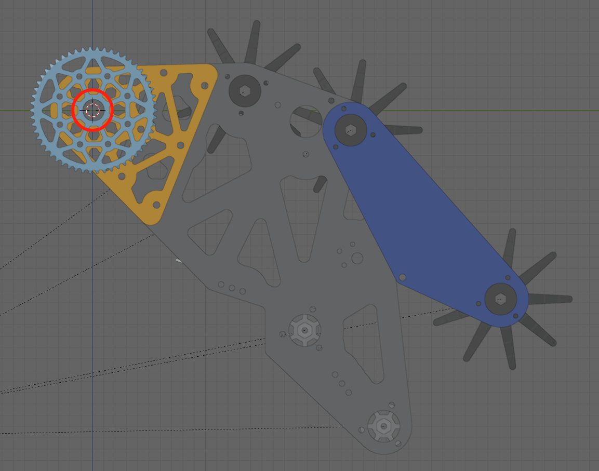
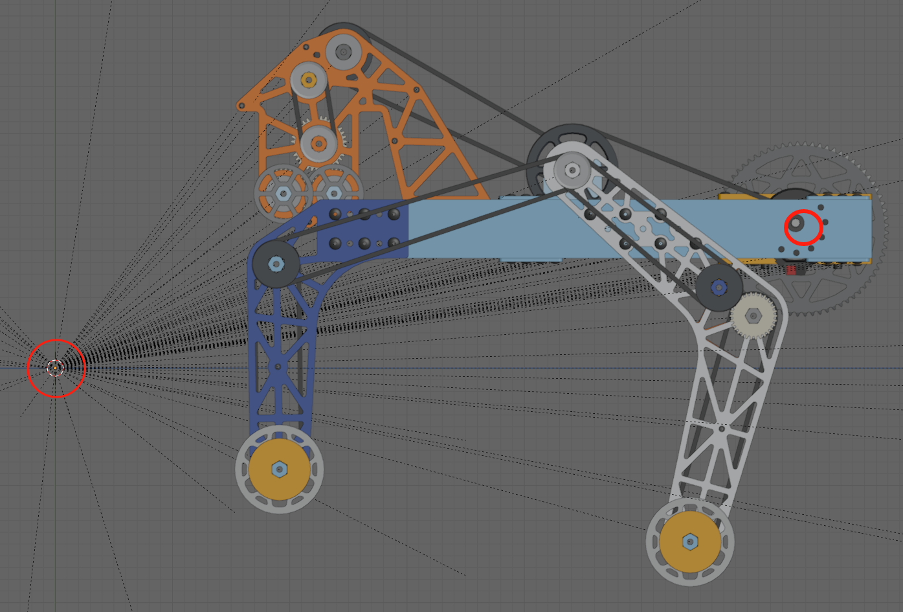
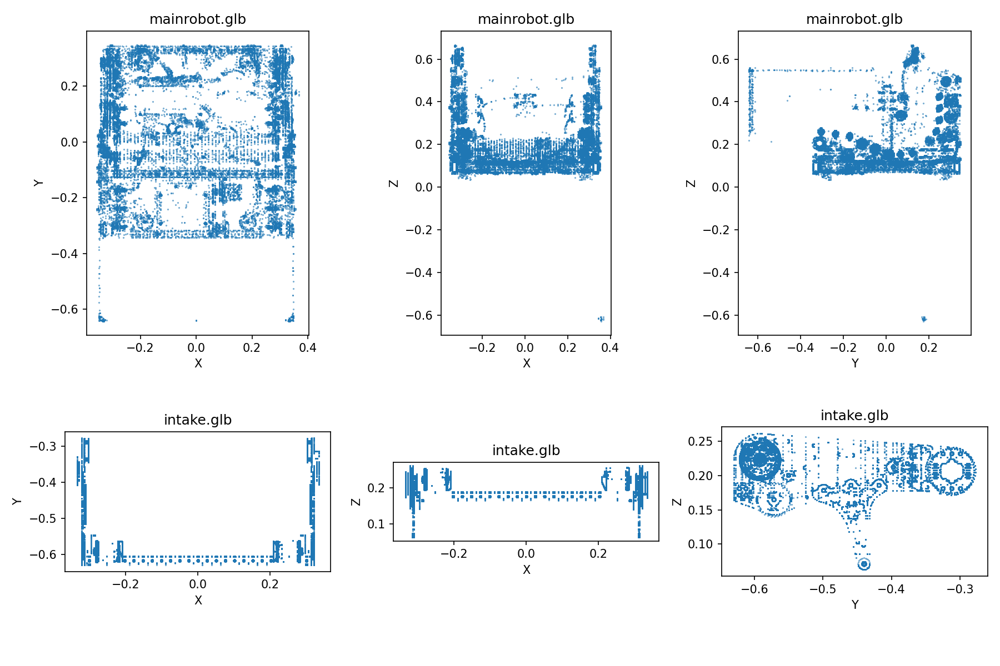

# 仿真流程 & 手柄操作说明（WPILib 2027 Alpha 7）

> 更新日期：2026-10-10。本文包含原有仿真与手柄说明，以及本次两个新 GLB 的接入、坐标校准、仿真抖动修复和排错流程。
> 环境：WPILib alpha7、Java 25 和其配套 AdvantageScope。本机配套 AdvantageScope 内部版本为 27.0.0-alpha-6；此前模型显示验证使用旧版软件。新布局与新电脑吸球/射球仍需实际验证。
> 当前模型名称：**8011 GLB 2027**。该配置已完成实际仿真显示和动作验证。
>
> **一句话结论**：手柄统一用 `CommandNiDsXboxController`，**直接调类自带的方法**
> （`getLeftY()` / `getRightX()` / `leftTrigger()` / `rightTrigger()`）；
> **绝不要手填裸轴号 `getHID().getRawAxis(n)`。**

---

## 1. 环境

| 项 | 值 |
|---|---|
| WPILib / GradleRIO | `2027.0.0-alpha-7`，以 `build.gradle` 为准 |
| Java | 25；可使用 WPILib 安装目录提供的 JDK |
| 日志框架 | AdvantageKit（`Logger.recordOutput` → NetworkTables） |
| NetworkTables | NT4：仿真服务器端口 `5810`，WebServer 端口 `5800` |
| 可视化 | WPILib alpha7 配套 AdvantageScope（本机内部版本 27.0.0-alpha-6），3D Field |
| 输入设备 | Xbox 手柄 |

`gradle.properties` 中的 `org.gradle.java.home` 是每台电脑自己的 JDK 路径，该文件已被 `.gitignore` 排除。**JDK 所在目录的 Alpha 版本名称，不代表项目依赖的版本**；项目的 GradleRIO 版本由 `build.gradle` 决定，JDK 则需要支持 Java 25。

如果在另一台电脑配置环境，可将 `org.gradle.java.home` 指向实际安装的 Java 25，例如：

```properties
org.gradle.java.home=<WPILib安装目录>/2027_alpha7/jdk
```

`<WPILib安装目录>` 是说明用占位符，实际配置时必须替换成自己电脑上的路径；建议使用正斜杠 `/`。不要提交个人 JDK 路径。迁移说明见 [migration-2027-alpha-7.md](migration-2027-alpha-7.md)。

---

## 2. 仿真启动流程

### 2.1 启动机器人程序

#### 新电脑第一次手动配置（可选独立离线包）

本 GitHub 上传目录不包含 `offline-kit`。有网络时使用正常 Gradle 下载；只有另行取得完整离线包时才执行下面的缓存复制命令。

无需使用 `offline-kit` 的快捷启动文件。先完成 WPILib 2027 alpha7 安装，在 WPILib VS Code 打开 `FRC8011_2027_Preseason`，打开 PowerShell 终端，确保终端位于包含 `build.gradle` 的项目目录。

1. 在项目目录创建或修改 `gradle.properties`，填写新电脑实际 JDK 路径。默认公共安装位置为：

   ```properties
   org.gradle.java.home=C:/Users/Public/wpilib/2027_alpha7/jdk
   ```

2. 在该终端手动将离线缓存复制到新电脑的默认 Gradle 用户目录。下面两条命令只补充/覆盖同名文件，不删除目标已有文件；完整总文件夹中的 `offline-kit` 必须保留在源码目录旁边。Robocopy 返回码 0～7 表示成功或存在复制差异，8 及以上表示失败。

   ```powershell
   robocopy "..\offline-kit\gradle-home\caches" "$env:USERPROFILE\.gradle\caches" /E /XF *.lock
   robocopy "..\offline-kit\gradle-home\permwrapper" "$env:USERPROFILE\.gradle\permwrapper" /E /XF *.lck
   ```

   若此前自己设置过 `GRADLE_USER_HOME`，以上目标目录应改为那个目录。WPILib 的 `maven` 本地依赖由安装程序安装，不在这两条复制命令中。

3. 在该终端设置 Java 25，并执行严格离线检查：

   ```powershell
   $env:JAVA_HOME = 'C:\Users\Public\wpilib\2027_alpha7\jdk'
   .\gradlew.bat --offline test jar extractReleaseNative simulateExternalJava --console=plain
   ```

   安装位置不同则修改上述 Java 路径。看到 `BUILD SUCCESSFUL` 后，按下面原有的命令面板流程启动即可。若要保证启动也严格不尝试访问网络，可在同一个终端手动执行 ` .\gradlew.bat --offline simulateJava --console=plain`，保持窗口打开。

#### 日常手动启动

1. 用 **2027_alpha7 WPILib VS Code** 打开本项目目录（包含 `build.gradle`）。
2. 如果修改过 Java 代码，先完全停止旧仿真进程。仅取消 Enabled 不会加载新代码。
3. `Ctrl+Shift+P` → `WPILib: Build Robot Code`，确认构建成功。
4. 再运行 `WPILib: Simulate Robot Code`，扩展选择中勾选 **GUI** 和 **Driver Station**。
5. 保持仿真终端与 GUI 打开，先在 Disabled 状态完成可视化连接。

本机使用仿真 GUI 的 Driver Station 控件即可；外部 FRC Driver Station 不是这一流程的额外必需步骤。

分发副本省略旧版 IDE 与系统界面截图，避免包含个人路径；启动步骤以以上文字说明为准。

### 2.2 选择新版模型资源目录

打开 **WPILib alpha7 配套 AdvantageScope**，找到 `Use Custom Assets Folder`。选择克隆的仓库内这个目录：

```text
<仓库根目录>/ascope/assets
```

**选 `ascope/assets`，不要选 `ascope`，也不要进入 `Robot_8011` 再选择。** 软件需要的是各个资源子文件夹的父目录。另一台电脑应选择自己项目中的同一个相对目录。

本次采用的资源结构：

```text
ascope/
├─ assets/                         ← Use Custom Assets Folder 选择这里
│  └─ Robot_8011/
│     ├─ config.json
│     ├─ model.glb                 ← 空基础模型
│     ├─ model_0.glb               ← mainrobot.glb 的原样副本
│     └─ model_1.glb               ← intake.glb 的原样副本
├─ layout-8011-live.json           ← 当前使用的布局
└─ 模型说明与几何检查图
```

`<仓库根目录>` 指自己克隆仓库的实际位置，不是需要创建的目录名。`Use Custom Assets Folder` 是复选开关：正常情况下，第一次点击已勾选项会关闭自定义目录，再点击才弹出目录选择窗口。若菜单勾选状态没有刷新，参见第 8 节的配置文件处理方法。正确路径保存后，重启无需再次点击开关。

用 `Show Assets Folder` 核对路径，正确目录里只应看到 `Robot_8011` 这个资源文件夹。


### 2.3 导入布局并连接 Simulator

1. `File → Import Layout`，选择项目中的 **`ascope/layout-8011-alpha7.json`**。
2. 不使用根目录 `layout.json`，也不使用旧 `ascope/layout.json` 作为这次新模型的操作入口。
3. Preferences 中确认 `Live Source = NetworkTables 4`。
4. `File → Connect to Simulator`，快捷键 `Ctrl+Shift+K`。
5. 打开 `3D Field` 标签页，确认 **Robot 选择 `8011 GLB 2027`；Component 紧跟 Robot，绑定 `Visualization/Components`，使用父 Robot 的模型**。
6. 场地选择 `FRC:2026 Field`：项目使用 2026 场地，工具版本为 2027 不代表场地也要选 2027。

连接本机仿真使用 `localhost` / `127.0.0.1`，NT4 端口为 `5810`，不用填写真实机器人的队号 IP。


`layout` 只负责窗口、图表和数据源绑定；GLB 与 `config.json` 负责模型外观和几何校准。**导入 layout 不会自动导入根目录两个 GLB，也不会替你重启机器人程序。**

### 2.4 分配手柄并验证动作

1. 插入 Xbox 手柄，在仿真 GUI 的 Joysticks / System Joysticks 控件中分配到 **端口 0**；代码的 `Ports.Joystick.DRIVER` 为 0。
2. 选择 `Teleop` / `Teleoperated` 并启用 `Enabled`；若 GUI 提供 DS Attached 选项，确认 DS 已连接。
3. 先验证左摇杆移动、右摇杆旋转，再验证 LT。
4. 按住 LT：intake 展开到 `0°`，roller 进入 `INTAKE`。
5. 松开 LT：roller 回 `IDLE`，**SIM 模式**中 intake 收起到 `99°`。
6. 要真正吸到场地中的球，还要把展开的 intake 驶到球旁。当前拾球区域在机器人自身 **−X 方向**、纵向距离 `0～0.6 m`、左右各 `0.35 m` 内。
7. Disabled 后，不再产生新的拾球/射球动作，intake 不应自动在两个端点之间切换。已经发出的球可能继续显示运动轨迹。

### 2.5 修改后怎样刷新

| 修改内容 | 需要的操作 |
|---|---|
| Java 代码 | 完全停止旧仿真，再重新编译运行 |
| GLB / 模型 config | 重新加载资源；本机采用退出并重开 AdvantageScope |
| layout JSON | 重新 Import Layout |
| AdvantageScope 的 prefs.json | 退出所有 AdvantageScope 窗口后修改，保存后再打开 |

重新导入布局不等于重新加载 Java；关闭使能也不等于停止旧进程。

> 仿真（SIM）模式下 AdvantageKit 只配了 NT4Publisher、**不写文件**，
> 所以仿真只能看实时数据，不能像真车那样回放日志文件。

---

## 3. Xbox 手柄按键映射（与当前 `RobotContainer.java` 一致）

### 3.1 驾驶

| 操作 | 功能 | 代码 |
|---|---|---|
| 左摇杆 Y | 前后平移（场地坐标系） | `driver.getLeftY()` |
| 左摇杆 X | 左右平移 | `driver.getLeftX()` |
| 右摇杆 X | 原地旋转（自旋） | `driver.getRightX()` |
| LB（左肩键） | 慢速模式（平移系数 0.7、旋转系数 0.5；正常旋转系数为 0.9） | `driver.getNiDsXboxController().getLeftBumperButton()` |
| `back` | 重置位姿（朝向归零 `Rotation2d.ZERO`） | `driver.back()` |

### 3.2 吸球 / 射球 / 其他

| 操作 | 功能 | 代码 |
|---|---|---|
| **LT（左扳机）** | **完整吸球宏** `Macro/FullIntake` | `driver.leftTrigger()` |
| **RT（右扳机）** | **完整射球宏** `Macro/AutoShoot` | `driver.rightTrigger()` |
| RB（右肩键） | deliver 宏 | `driver.rightBumper()` |
| A | 强制 intake idle | `driver.a()` |
| X | 瞄准 −90° | `driver.x()` |
| B | 瞄准 +90° | `driver.b()` |
| Y | 自动前往 Trench（`ProceedToPoint`） | `driver.y()` |
| D-pad 上 / 下 / 左 / 右 | 固定点射球（左塔 / 右塔 / 左壕沟 / 右壕沟） | `driver.getHID().povUp()/.povDown()/.povLeft()/.povRight()` |

> 十字键是唯一需要走 `getHID()` 的地方——因为 `CommandNiDsXboxController` **没有** `dpad*()` 方法，
> 只能用底层 `CommandGenericHID` 的 `pov*()`（POV 帽 = 十字键，同一回事）。这与扳机不同，见 4.6 节。

### 3.3 宏命令行为

**吸球宏 `Macro/FullIntake`**（`intakeMacroCommand`）：

- 按住 LT 期间：pivot 放下（`SlamArmGoal.DEPLOY`）+ roller 吸球（`RollerGoal.INTAKE`）
- 松开：roller 回 `IDLE`；本次新增 **SIM 模式下 pivot 回 `RETRACT`（99°）**，真车分支的松开行为没有加入自动收起。

**射球宏 `Macro/AutoShoot`**（`shootMacroCommand`）：

1. `spinUpCommand`（目标由 `shootGoalSupplier` 给出，遥操作为 `MANUAL_LAUNCH`）
2. 打开瞄准（`setAimToShake` / `setAimToHub`）
3. 等待 **0.3s** **且** 对准到位（`isAimToHubAtGoal()`）
4. 发射：手柄震动 + `launchCommand` + `smartIndexerCommand` 喂球 + `injectCommand` + `pivotBumpCommand`
5. `finallyDo`：shooter / indexer / intake 全部复位（`STOP`）

代码位于 `RobotContainer.java` 的 `MyCommand.shootMacroCommand()` / `intakeMacroCommand()`。

---

## 4. 手柄映射原理：为什么必须用 `CommandNiDsXboxController`

这一节说明**手柄代码的写法规范**。不按这个写，扳机和右摇杆就会整体错位。

### 4.1 根因：Xbox 手柄的轴有**两套**编号习惯

同一个手柄的 6 个轴，存在两套互不相同的编号：

| 轴 | 经典 FRC DS 顺序 | SDL 顺序 |
|---|---|---|
| 左摇杆 X（LX） | `0` | `0` |
| 左摇杆 Y（LY） | `1` | `1` |
| 左扳机（LT） | **`2`** | **`4`** |
| 右扳机（RT） | **`3`** | **`5`** |
| 右摇杆 X（RX） | **`4`** | **`2`** |
| 右摇杆 Y（RY） | **`5`** | **`3`** |

- **经典顺序**（LT=2、RT=3、RX=4、RY=5）：老 NI Driver Station 上报的顺序。
- **SDL 顺序**（LT=4、RT=5、RX=2、RY=3）：SDL 游戏手柄 API 的顺序。

> **关键**：WPILib 2027 Alpha 7 有**两个** Xbox 类，各自内置了其中一套枚举；
> 而 **2027 Alpha 7 的仿真上报的是"经典顺序"**。类选错了，读出来的轴就整体错位。

### 4.2 两个 Xbox 类的枚举对照（抄自各自源码）

| 轴 | `XboxController`（SDL） | `NiDsXboxController`（经典） |
|---|---|---|
| 左摇杆 X | `LEFT_X(0)` | `LEFT_X(0)` |
| 左摇杆 Y | `LEFT_Y(1)` | `LEFT_Y(1)` |
| 左扳机 LT | `LEFT_TRIGGER(4)` | `LEFT_TRIGGER(2)` |
| 右扳机 RT | `RIGHT_TRIGGER(5)` | `RIGHT_TRIGGER(3)` |
| 右摇杆 X | `RIGHT_X(2)` | `RIGHT_X(4)` |
| 右摇杆 Y | `RIGHT_Y(3)` | `RIGHT_Y(5)` |

两个类的 **getter 方法名一模一样，但底层读的轴号不同**：

```java
// XboxController（SDL）：RIGHT_X 枚举 = 2，所以 getRightX() 读轴 2
public double getRightX() { return MathUtil.applyDeadband(getAxis(Axis.RIGHT_X), m_rightXDeadband); }

// NiDsXboxController（经典）：RIGHT_X 枚举 = 4，所以 getRightX() 读轴 4
public double getRightX() { return m_hid.getRawAxis(Axis.RIGHT_X.value); }
```

> 源码注释里明确写了——`NiDsXboxController` 才是 "through the official NI DS" 的顺序。

### 4.3 用错的症状

若用 `CommandXboxController`（SDL）去读"经典顺序"的仿真输入，就会这样：

| 物理操作 | 仿真上报轴号（经典） | `XboxController` 读到的方法 | 现象 |
|---|---|---|---|
| 左摇杆 X / Y | 0 / 1 | `getLeftX()` / `getLeftY()` | ✅ 正常 |
| **左扳机 LT** | 2 | `getRightX()`（SDL 里 RIGHT_X=2） | ❌ **转圈** |
| **右扳机 RT** | 3 | `getRightY()`（SDL 里 RIGHT_Y=3） | ❌ **无反应** |
| 右摇杆 X | 4 | `getLeftTrigger()`（SDL 里 LT=4） | ⚠️ 误触发吸球 |
| 右摇杆 Y | 5 | `getRightTrigger()`（SDL 里 RT=5） | ⚠️ 误触发射球 |

所以"按 LT 转圈、按 RT 没反应、碰右摇杆却在吸球"，全都源于**类选错了**。

### 4.4 规范：换类 + 调类自带的方法

**核心做法**：把 driver 从 `CommandXboxController` 换成 `CommandNiDsXboxController`，
然后**直接调类自带的 getter / trigger 方法**——让类内部的 `Axis` 枚举替你决定读哪根轴。

**为什么不能手填裸轴号**：`driver.getHID().getRawAxis(4)` 等于**绕过枚举、手抄魔数**。
它把 `NiDsXboxController` 里已经写好的枚举映射，用魔数又抄了一遍——既难读、又不通用，
一旦轴号变动就要满地找 `2/3/4/5`。**方向对了（走类方法），但必须是在"对的类"上调用。**

> `CommandXboxController` 的 `getLeftTriggerAxis()` 底层还是 SDL 轴 4，
> 所以**光换方法名不换类，照样错**。

### 4.5 改法对照（改前 → 改后）

```java
// ===== 换类 =====
// 前：import org.wpilib.command2.button.CommandXboxController;
//     CommandXboxController driver = new CommandXboxController(Ports.Joystick.DRIVER);
// 后：import org.wpilib.command2.button.CommandNiDsXboxController;
//     CommandNiDsXboxController driver = new CommandNiDsXboxController(Ports.Joystick.DRIVER);

// ===== 旋转（右摇杆 X） =====
// 前（魔数，读裸轴 4）
// () -> -driver.getHID().getRawAxis(4) * (driver.getController().getLeftBumperButton() ? 0.5 : 0.9)
// 后（类自带 getter，经典轴 4）
() -> -driver.getRightX() * (driver.getNiDsXboxController().getLeftBumperButton() ? 0.5 : 0.9)

// ===== LT 吸球 =====
// 前（魔数）：new Trigger(() -> driver.getHID().getRawAxis(2) > 0.5).whileTrue(...)
// 后（类自带 trigger，经典轴 2，自带 0.5 阈值）
driver.leftTrigger().whileTrue(MyCommand.intakeMacroCommand(intake));

// ===== RT 射球 =====
// 前（魔数）：new Trigger(() -> driver.getHID().getRawAxis(3) > 0.5).whileTrue(...)
// 后（类自带 trigger，经典轴 3，自带 0.5 阈值）
driver.rightTrigger().whileTrue(MyCommand.shootMacroCommand(...));
```

### 4.6 按键也要跟着改 / 十字键只能走 POV 帽

两个类的**按键编号也不一样**，换类后按键相关方法也要跟着换：

| 原代码（`CommandXboxController`） | 改后（`CommandNiDsXboxController`） | 说明 |
|---|---|---|
| `driver.getController().getLeftBumperButton()` | `driver.getNiDsXboxController().getLeftBumperButton()` | 底层对象方法名不同 |
| `driver.view()` | `driver.back()` | NiDs 叫 BACK（编号 6） |
| `driver.dpadUp()/Down()/Left()/Right()` | `driver.getHID().povUp()/povDown()/povLeft()/povRight()` | NiDs 没有 dpad 方法，走 POV 帽 |

按钮编号对照：

| 按键 | `XboxController`（SDL） | `NiDsXboxController`（经典） |
|---|---|---|
| A / B / X / Y | 0 / 1 / 2 / 3 | 0 / 1 / 2 / 3 |
| 左肩键 LB | `LEFT_BUMPER(9)` | `LEFT_BUMPER(4)` |
| 右肩键 RB | `RIGHT_BUMPER(10)` | `RIGHT_BUMPER(5)` |
| view / back | `VIEW(4)` | `BACK(6)` |
| menu / start | `MENU(6)` | `START(7)` |
| 左 / 右摇杆按下 | 7 / 8 | 8 / 9 |
| 十字键 | `DPAD_UP..RIGHT(11..14)` | （无，走 POV 帽） |

> **十字键是唯一的例外**：`CommandNiDsXboxController` 没有 `dpad*()`，只能用
> `getHID().povUp()/...`（POV 帽 = 十字键）。这和扳机不一样——扳机要用类自带的 `leftTrigger()`，不要走 `getHID()`。

### 4.7 三条红线

1. **不要手填裸轴号** `getHID().getRawAxis(n)`。要读轴就用类自带 getter。
2. **不要在错误的类上调方法**。`CommandXboxController.getLeftTriggerAxis()` ≠ 经典 LT。
3. **十字键走 POV 帽，扳机走类方法**。两者的正确写法不同，别混。

> **真车与仿真一致**：真车走 NI Driver Station，上报的也是经典顺序，所以这个改法
> **真车和仿真通用**，不需要"真车前还原"。

---

## 5. 如何定位手柄映射问题（诊断方法）

用一个独立的 **NT4 客户端**连 `localhost:5810`，实时读以下 topic：

| Topic | 含义 |
|---|---|
| `/AdvantageKit/RealOutputs/CommandsAll/TeleopController` | 机器人是否在 Teleop 驾驶 |
| `/AdvantageKit/RealOutputs/CommandsAll/Macro/FullIntake` | 吸球宏是否在跑 |
| `/AdvantageKit/RealOutputs/CommandsAll/Macro/AutoShoot` | 射球宏是否在跑 |
| `/AdvantageKit/RealOutputs/Shooter/Goal` | 射球器目标（`STOP` / `MANUAL_LAUNCH` …） |
| `/AdvantageKit/RealOutputs/Shooter/FeedEnabled` | 喂球开关 |
| `/AdvantageKit/RealOutputs/Visualization/Fuel/hasGamePiece` | 车上球数 |

**判断依据**：若机器人已 Enable（`TeleopController=true`），但按 LT/RT 时 `FullIntake`/`AutoShoot`
一直是 `false`、`Goal` 一直是 `STOP` —— 说明**不是命令逻辑问题，而是触发绑定压根没被触发**，
应先检查输入和触发绑定，再检查命令是否被其他命令中断；这一现象本身不能排除所有命令逻辑问题。

另外 `TeleopController.execute()` 会把 `Swerve/TeleopController/Rotation`（即 `-getRightX()`）打到 NT，
按 LT 时若能看到它变化 → 直接证明 LT 被当成了右摇杆 X。

---

## 6. 两个 GLB 是怎样对齐的

### 6.1 为什么直接复制文件还不够

模型来源为 `mainrobot.glb` 和 `intake.glb`。本次没有重新建模、修改网格或重新导出这两个文件；最终资源中的两个副本与原文件 SHA256 相同。分发副本只保留 `ascope/assets/Robot_8011/model_0.glb` 和 `model_1.glb`，不在根目录重复保存原始模型。

工作分成三层：

1. **资源文件与命名**：软件必须能识别目录、模型名和组件文件名。
2. **模型自身校正**：将 intake 的转轴移到模型局部原点。
3. **运行时安装与运动**：代码把主体和 intake 安装到机器人坐标系，并用实际仿真角度驱动 intake。

此前主体侧倒、intake 在车外绕动，是因为沿用旧模型的旋转、安装位置和角度基准。这些数值不能直接用于新的 GLB。

### 6.2 viz 图片说明的转轴原理

[viz/README.md](viz/README.md) 要求活动机构的旋转中心放在模型原点：




正确图中，坐标轴交点与红圈标出的铰链重合。错误图中，原点在左下角，而铰链在右侧。直接旋转错误模型会让它绕远处原点运动，即看到整个 intake 在车旁“公转”。

因此，不能只在静止状态把 intake 挪到车身旁；还要确保展开时围绕固定铰链转动。README 中“校正值可设为零”的示例，仅适用于导出时原点和方向已经正确的模型。

### 6.3 确认新模型的坐标方向

本次读取 GLB 的节点与顶点，并生成三个投影视图进行检查。辅助脚本为 `ascope/check_model_coordinates.py`，生成图为 `ascope/model-coordinate-views.png`：



图中可以确认：新模型 **Z 轴向上**，X 横跨车身宽度，intake 沿模型的负 Y 方向向外展开。旧代码还施加了 X 轴 90° 旋转，导致本来向上的 Z 被转向水平方向，机器人侧倒。

新版主体只绕 Z 轴旋转 −90°：

```java
new Rotation3d(0.0, 0.0, -Math.PI / 2.0)
```

这样保留 Z 向上，并将模型负 Y 方向映射到机器人 −X 方向，与代码的拾球区域一致。

### 6.4 把 intake 转轴移到原点，再安装回车身

当前采用的模型局部转轴坐标为：

```text
P = [0.0, -0.30235, 0.2075] m
```

该值根据 GLB 几何侧视检查确定，并通过本机实际画面确认状态正确；它不是从 CAD 图纸标注读取的精密机械尺寸。换另一份模型时应重新校准。

`ascope/assets/Robot_8011/config.json` 中的第二个组件对应 intake：

```json
{
  "zeroedRotations": [],
  "zeroedPosition": [0, 0.30235, -0.2075]
}
```

这里使用 **−P**，把模型中的实际铰链搬到局部原点。随后 `RobotContainer.configureVisualization(Visualizer)` 用 **+P** 将铰链安装回车身：

```java
new Transform3d(
    0.0,
    -0.30235,
    0.2075,
    new Rotation3d(-intake.getPivotPositionRad(), 0.0, 0.0))
```

对于模型上的一个点 v，可理解为：`安装坐标 P + 旋转后的 (v − P)`，随后再叠加主体朝向与机器人场地位置。在 0° 时，−P 和 +P 相消，模型恢复原来的展开装配关系；角度变化时，始终绕 P 转动。

**以后修改铰链坐标，要同步修改 Java 中的 +P 和 config 中的 −P，不能只改一边。**

### 6.5 为什么角度表达式也要改

新的 `intake.glb` 是水平展开状态导出的：

| 仿真角度 | 对应状态 | 模型局部旋转 |
|---|---|---|
| 0° | 展开 | 0°，保持 GLB 导出姿态 |
| 99° | 收起 | 绕模型 X 轴 −99° |

因此旧表达式 `-99° + 当前角度` 已被替换成 `-当前角度`。负号决定向上收起的方向；它来自这一份模型的坐标方向，不能当作所有模型都通用的公式。

### 6.6 最终模型配置与组件编号

资源文件夹名称为 `Robot_8011`，下划线前的 `Robot` 是资产类型。界面显示名来自 config 的 `name`，不是文件夹名。

本次最终 config 为：

```json
{
  "name": "8011 GLB 2027",
  "rotations": [],
  "position": [0, 0, 0],
  "cameras": [],
  "components": [
    {"zeroedRotations": [], "zeroedPosition": [0, 0, 0]},
    {"zeroedRotations": [], "zeroedPosition": [0, 0.30235, -0.2075]}
  ]
}
```

| 文件 / 数组编号 | 内容 | Java 中的组件 |
|---|---|---|
| `model.glb` | 空基础模型 | 不承担可动模型显示 |
| `model_0.glb` / `components[0]` | 新主体 mainrobot | `chassis`，编号 0 |
| `model_1.glb` / `components[1]` | 新 intake | `intake`，编号 1 |

旧 hopper 编号 2 已移除，避免在新主体上叠加旧料仓。代码发布两个组件 Pose3d，与 config 的两个组件严格对应。`zeroedRotations` 使用 JSON 数组 `[]`，不是旧示例中的对象 `{}`。

## 7. 2026-10-09 代码改动及原因

### 7.1 RobotContainer.java：模型、宏命令和球仿真

文件：`src/main/java/frc/robot/RobotContainer.java`。

| 方法 / 位置 | 改动 | 原因 |
|---|---|---|
| `configureVisualization(Visualizer)` 的主体注册 | 父节点从字符串 `"base"` 改为 `Visualizer.BASE_FRAME`（`"robot"`） | 与 Visualizer 定义的根坐标名称一致，避免出现 `null/chassis` 路径 |
| 同方法主体旋转 | 从 X 90°、Z 90°改为仅 Z −90° | 新模型已是 Z 向上，旧旋转会把主体放倒 |
| 同方法 intake 变换 | 安装坐标改为 P，旋转改为 `-getPivotPositionRad()` | 与 config 的 −P 配合，绕实际铰链运动，匹配展开导出姿态 |
| 同方法旧 hopper | 删除编号 2 的注册 | 新资源只包含两个组件，不加载旧料仓 |
| `MyCommand.intakeMacroCommand()` 的结束回调 | roller 置 IDLE；仅 SIM 模式把 pivot 置 RETRACT | 松开 LT 后能收起，便于反复验证；没有把此项自动收起行为加到 REAL 分支 |
| `configureVisualization(GamePieceVisualizer)` | 拾球和新增射球条件加入 `RobotState.isEnabled()` | 这些后台命令设置了 `ignoringDisable(true)`，必须在实际动作条件中检查使能 |
| 新增 `logSimulationControls()` | 发布 Enabled、LT、RT、角度和目标状态 | 区分手柄没输入、命令没触发与模型显示错误 |

主体变换与 config 必须一起使用当前版本；分发副本已排除旧资源和中间配置。

### 7.2 Intake.java：停止 Disabled 输出，修复展开时的端点振荡

文件：`src/main/java/frc/robot/subsystem/intake/Intake.java`，方法 `periodic()`。

原来 Disabled 的检查在最后，只清理状态和 debounce，前面的电机目标逻辑仍会运行。现在完成输入读取后，若 Disabled，立即：

1. roller 目标置 `IDLE`。
2. 停止 pivot 与 roller 输出。
3. 重置判定状态并记录角度。
4. `return`，不再继续执行目标控制。

另一个问题来自 SIM 的简化模型：它收到负电流直接跳到展开端点，正电流直接跳到收起端点。原真实机构控制在角度低于 70°时反转电流，套到这个模型后会产生：

```text
99° → 负电流 → 0° → 正电流 → 99° → 负电流 → 0° → ……
```

这就是画面中机构反复切换状态的原因，并不能单凭这一现象认定射球宏一直运行。现在 `DEPLOY` 在 **SIM** 分支固定使用展开电流，不再执行真实机构的低角度电流反转；REAL 分支保留原展开控制。

### 7.3 SlamArmIOSim.java：零电流与停止保持角度

文件：`src/main/java/frc/lib/interfaces/motor/SlamArmIOSim.java`。

- `setCurrent(0.0)` 现在直接返回，保留当前角度。旧判断把零归入非正电流分支，会选择其中一个端点。
- 显式实现 `stop()`：保持当前角度。原接口的默认 `stop()` 本身也是空实现，这项主要把简化模型的停止语义写清楚；端点振荡的主要修复在 `Intake.periodic()`。

当前仍是**端点模型**，没有加入惯量、重力和连续速度积分。验证的是目标、状态和可视化动作，不是机械运动时间或真实动力学精度。

### 7.4 Robot.java：每周期发布诊断

文件：`src/main/java/frc/robot/Robot.java`，方法 `robotPeriodic()`。

在 `CommandScheduler.getInstance().run()` 后调用 `robotContainer.logSimulationControls()`，记录该周期的输入和 intake 状态。这些额外诊断只在 SIM 模式发布。

### 7.5 资源、布局和本机偏好设置

| 文件 | 本次用途 / 改动 |
|---|---|
| `ascope/assets/Robot_8011/` | 隔离后的有效资源目录，只含 config、空基础 GLB 和两个新 GLB |
| `ascope/layout-8011-alpha7.json` | 基于原布局创建；保留实时 NT 数据源，机器人与组件名统一为 `8011 GLB 2027` |
| 同一布局的 Ghost / vision 行 | 隐藏绿色、橙色 Duck Bot Ghost 和青色视觉连线，便于观察真实模型；没有禁用机器人视觉算法 |
| 同一布局的 Line Graph | 左轴显示 LT，右轴显示 intake 角度，支持排错 |
| `ascope/check_model_coordinates.py` | GLB 坐标检查与投影视图脚本，需要 Python、NumPy、Matplotlib；正常仿真不必运行 |
| `%APPDATA%/AdvantageScope/prefs.json` | 本机 `userAssetsFolder` 改为项目的 `ascope/assets` 绝对路径；这是应用配置，不是仓库文件 |

开发环境曾存在另一个名为 `8011 FAKER` 的用户模型，因此新模型使用 **`8011 GLB 2027`**，避免同名资源让人误选旧模型。分发副本只保留最终资源目录。

## 8. 常见问题与诊断顺序

### 8.1 自定义资源导入警告

先检查选中路径是否为 `ascope/assets`。旧 `ascope` 目录混有 `Robot` 等目录，不符合 `Robot_名称` 格式；后来也包含 `assets` 子目录，不能把整个 `ascope` 当作干净的资源父目录。当前资源父目录下只有合法的 `Robot_8011`。

如果仍出现警告，记录具体失败的资源名称或警告原文；不要仅凭存在警告就认为新 GLB 一定损坏。

### 8.2 Use Custom Assets Folder 有勾但点了看似没有反应

本次检查安装包的菜单逻辑，确认这是复选开关。关闭时 `userAssetsFolder` 会变成 null，重新开启时才显示选择窗口；界面状态没有同步刷新时，可退出后重开。

若菜单无法正常使用，可采用以下办法：**先完全退出 AdvantageScope，备份 prefs.json，再只修改 `userAssetsFolder`，然后重开软件**。设置示意：

```json
"userAssetsFolder": "<仓库根目录>/ascope/assets"
```

Windows 的文件位置为 `%APPDATA%/AdvantageScope/prefs.json`：可在资源管理器地址栏输入 `%APPDATA%\AdvantageScope` 打开。备份可以命名为 `prefs.json.before-8011-assets.bak`，放在同目录，属于本地应用配置，不应提交到仓库。

`<仓库根目录>` 必须替换为自己的仓库绝对路径。JSON 中建议用正斜杠 `/`；若使用反斜杠，应写为 `\\`。修改时保留其他字段，不要用上面这一行覆盖整个文件，也不要将个人偏好设置中的绝对路径复制到团队文档或提交文件。

这只设置模型搜索目录，不会自动导入 layout，也不会重启仿真代码。

### 8.3 主体侧倒、模型重叠或看见绿色机器人

- 先确认模型名为 `8011 GLB 2027`，避免仍使用旧 `8011 FAKER`。
- 主体侧倒：检查 Java 是否为仅 Z −90°，且旧仿真已完全停止。
- intake 在车外绕动：检查 config 的 −P 与 Java 的 +P 是否成对、角度基准是否为展开 0°。
- 绿色半透明机器人：原 layout 的 Duck Bot Ghost，代表视觉估计等辅助位置；新版布局已隐藏它。
- 青色线条：视觉辅助连线；新版布局已隐藏对应显示行。

### 8.4 按 LT 没动作

在 AdvantageScope 的 `Line Graph` 查看 LT 和角度，或在左侧数据树展开 `/AdvantageKit/RealOutputs/Simulation`：

| 数据项 | 正常表现 |
|---|---|
| `Enabled` | 启用时 true，禁用时 false |
| `Controls/LT` | 松开接近 0，按下接近 1；触发阈值为 0.5 |
| `Controls/RT` | 同样反映右扳机输入 |
| `Intake/AngleDeg` | SIM 中收起 99，展开 0 |
| `Intake/Goal` | 按 LT 为 DEPLOY，松开后为 RETRACT |
| `Intake/RollerGoal` | 按 LT 为 INTAKE，松开后为 IDLE |

按这个顺序判断：

1. **LT 数值不变**：检查物理手柄是否被识别、是否分配到端口 0、是否按的是 LT。
2. **LT 变化，但 Enabled 为 false**：启用 Teleop，确认 DS 已连接。
3. **输入和使能正常，但 Goal 不变**：检查 `Macro/FullIntake` 是否运行、是否被其他占用 intake 的宏中断。
4. **角度在变化，但模型不动**：检查 Robot Component 行是否显示，模型名是否正确，绑定是否是 `Visualization/Components`。
5. **intake 展开，但球没被吸走**：把机器人自身 −X 侧的 intake 驶到球旁；展开不代表任意距离都能拾球。

### 8.5 数据源丢失或重启后还看到旧状态

实时 3D 显示至少需要：

| 实际 NT 数据路径 | 3D 类型 |
|---|---|
| `/AdvantageKit/RealOutputs/Odometry/EstimatedPose` | Robot |
| `/AdvantageKit/RealOutputs/Visualization/Components` | Robot Component |
| `/AdvantageKit/RealOutputs/Visualization/Fuel/pickableGamePiecePose` | Game Piece / Fuel |
| `/AdvantageKit/RealOutputs/Visualization/Fuel/movingGamePieces` | Game Piece / Fuel |
| `/AdvantageKit/RealOutputs/Visualization/Fuel/onboardGamePiecePose` | Game Piece / Fuel |

保存布局中的 `NT:` 是软件的数据源标识。若导入后显示字段不存在，可从实时数据树重新拖入对应字段；Robot 和 Robot Component 要使用同一个模型。

测试期间曾发现 NT4 5810 与摄像头端口被占用，说明可能已有仿真进程运行。先停止旧进程，再启动新仿真，防止 AdvantageScope 连到旧代码。不要把取消 Enabled 当成停止进程。

## 9. 验证方式与本次结果

本次针对性检查执行：

```powershell
.\gradlew.bat test --tests frc.robot.IntakeControlsSimulationTest --tests frc.lib.interfaces.motor.SlamArmIOSimTest --tests frc.robot.RobotSimulationTest --offline --console=plain
```

`--offline` 适用于依赖已经缓存的本机；首次安装缺少依赖时需联网下载。执行前最好停止正在运行的仿真，避免 NT4 与摄像头端口冲突。本次测试曾出现端口占用警告，但针对性断言仍通过；这不代表该测试进程成功成为实时 NT4 服务器。

| 测试文件 | 验证内容 | 本次结果 |
|---|---|---|
| `src/test/java/frc/robot/IntakeControlsSimulationTest.java` | 模拟 NI-DS LT 输入，验证按下展开、松开收起，以及禁用后即使目标为 DEPLOY 也不改变角度 | 通过 |
| `src/test/java/frc/lib/interfaces/motor/SlamArmIOSimTest.java` | 正负电流选择端点、零电流和 stop 保持角度 | 通过 |
| `src/test/java/frc/robot/RobotSimulationTest.java` | 机器人启动及生命周期，并检查 Disabled intake 角度保持 | 通过 |

编译与以上三项检查通过后，使用者在本机重新加载新代码、资源目录和布局，已确认当前显示与动作状态正确。测试不替代 CAD 尺寸校准，也不验证真实电机、接线、惯量或机械碰撞。

成功状态应满足：主体直立、intake 铰链与车身连接、按 LT 展开、松开收起、Disabled 不自动往复，且左侧 NT 数据持续更新。

## 10. 参考资料

- WPILib 2027 变更日志：<https://docs.wpilib.org/en/latest/docs/yearly-overview/yearly-changelog.html>
- Alpha 7 发布：<https://github.com/wpilibsuite/allwpilib/releases/tag/v2027.0.0-alpha-7>
- 轴映射讨论：<https://github.com/wpilibsuite/frc-docs/issues/926>
- 本项目迁移记录：`docs/migration-2027-alpha-7.md`
- 仿真快速开始：`docs/setup/README.md`
- 手柄映射专题（本文第 4 节的展开版）：`docs/xbox-controller-mapping-fix.md`
- WPILib 源码（供对照）：
  - `NiDsXboxController.java` → `org/wpilib/driverstation/NiDsXboxController.java`
  - `XboxController.java` → `org/wpilib/driverstation/XboxController.java`
  - `CommandNiDsXboxController.java` → `org/wpilib/command2/button/CommandNiDsXboxController.java`
