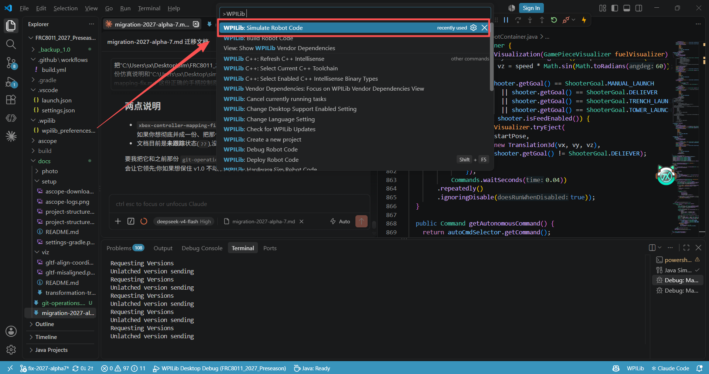
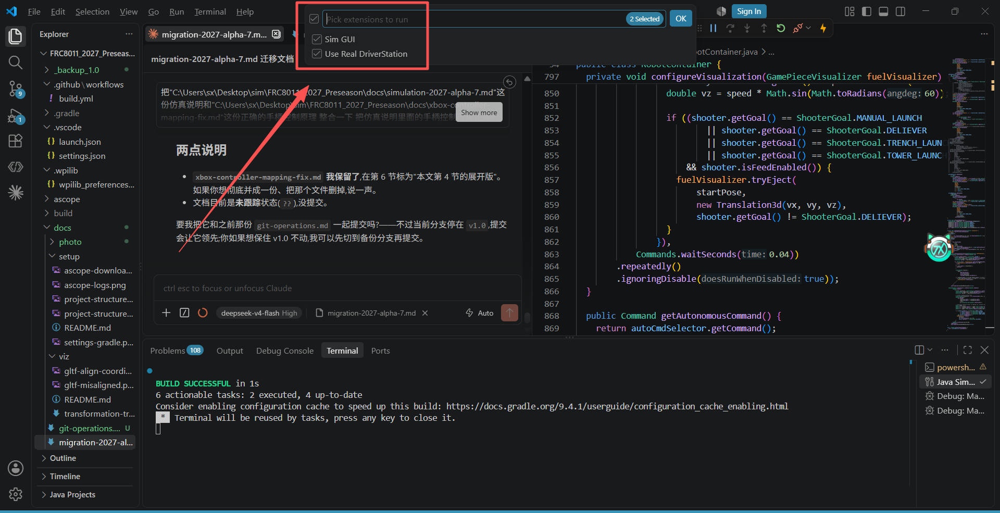
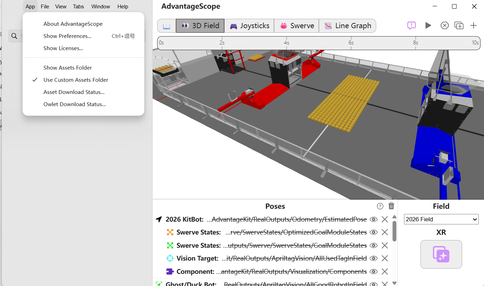
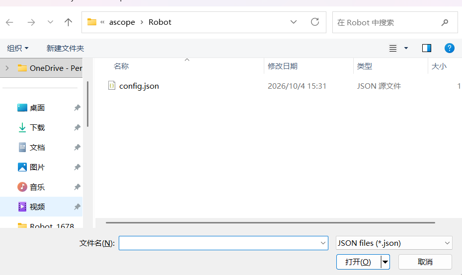
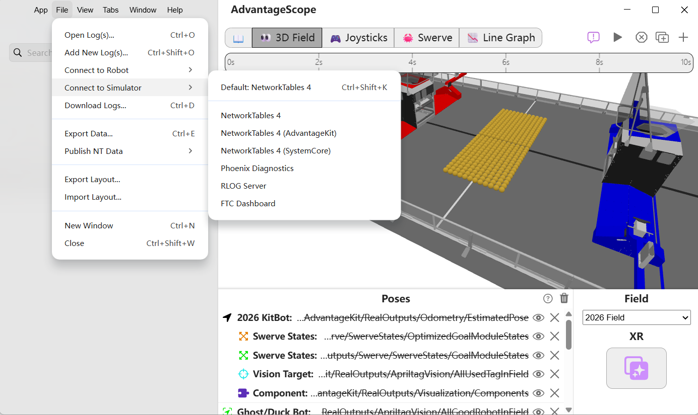

# 仿真流程 & 手柄操作说明（WPILib 2027 Alpha 7）

> 本文是 2027 Alpha 5 环境下的**一体化操作说明**：从启动本地仿真、连 AdvantageScope，
> 到用 Xbox 手柄驾驶 / 吸球 / 射球的完整按键表，再到手柄映射"**为什么这样写**"的原理与规范。
>
> **一句话结论**：手柄统一用 `CommandNiDsXboxController`，**直接调类自带的方法**
> （`getLeftY()` / `getRightX()` / `leftTrigger()` / `rightTrigger()`）；
> **绝不要手填裸轴号 `getHID().getRawAxis(n)`。**

---

## 1. 环境

| 项 | 值 |
|---|---|
| WPILib / GradleRIO | `2027.0.0-alpha-5` |
| Java | 25（JDK 位于 `C:/Users/Public/wpilib/2027_alpha5/jdk`） |
| 日志框架 | AdvantageKit（`Logger.recordOutput` → NetworkTables） |
| NetworkTables | NT4：仿真服务器端口 `5810`，WebServer 端口 `5800` |
| 可视化 | AdvantageScope（3D） |
| 输入设备 | Xbox 手柄 |

> `gradle.properties` 里 `org.gradle.java.home` 指向的是 `2027_alpha5/jdk`，但实际编译用的是 25
> （详见 `docs/migration-2027-alpha-5.md`）。若机器默认 JDK 不是 25，请从 WPILib VS Code 启动，或手动设 `JAVA_HOME`。

---

## 2. 仿真启动流程

1. 用 **WPILib VS Code（2027）** 打开项目。
2. `Ctrl+Shift+P` → **`WPILib: Simulate Robot Code`**（即 `Simulate Desktop Robot`）。
   - 会弹出 **Glass 仿真 GUI**，里面包含 Driver Station（简称 DS）。**GUI 和 DS 都要选中**。


3. 打开**FRC Driver Station** ：
4. 打开 **AdvantageScope**：
   - 需要 3D 场地 / 机器人时，导入 `ascope/layout.json` 和对应 `Robot_*` 模型资产。
选择“Use Custom Assets Folder”打开你有的机器人文件夹。



选择`File`,看到下面的`import layout`打开你有的json文件。



- `File → Connect to Simulator`（`Ctrl+Shift+K`），选择`NetworkTables4`连到本地仿真。


5. 用 Xbox 手柄开始驾驶。

> 仿真（SIM）模式下 AdvantageKit 只配了 NT4Publisher、**不写文件**，
> 所以仿真只能看实时数据，不能像真车那样回放日志文件。

---

## 3. Xbox 手柄按键映射（与当前 `RobotContainer.java` 一致）

### 3.1 驾驶

| 操作 | 功能 | 代码 |
|---|---|---|
| 左摇杆 Y | 前后平移（场地坐标系） | `driver.getLeftY()` |
| 左摇杆 X | 左右平移 | `driver.getLeftX()` |
| 右摇杆 X | 原地旋转（自旋） | `driver.getRightX()` |
| LB（左肩键） | 慢速模式（平移 ×0.7，旋转 ×0.5） | `driver.getLeftBumperButton()` |
| `back` | 重置位姿（朝向归零 `Rotation2d.ZERO`） | `driver.back()` |

### 3.2 吸球 / 射球 / 其他

| 操作 | 功能 | 代码 |
|---|---|---|
| **LT（左扳机）** | **完整吸球宏** `Macro/FullIntake` | `driver.leftTrigger()` |
| **RT（右扳机）** | **完整射球宏** `Macro/AutoShoot` | `driver.rightTrigger()` |
| RB（右肩键） | deliver 宏 | `driver.rightBumper()` |
| A | 强制 intake idle | `driver.a()` |
| X | 瞄准 −90° | `driver.x()` |
| B | 瞄准 +90° | `driver.b()` |
| Y | 自动前往 Trench（`ProceedToPoint`） | `driver.y()` |
| D-pad 上 / 下 / 左 / 右 | 固定点射球（左塔 / 右塔 / 左壕沟 / 右壕沟） | `driver.getHID().povUp()/.povDown()/.povLeft()/.povRight()` |

> 十字键是唯一需要走 `getHID()` 的地方——因为 `CommandNiDsXboxController` **没有** `dpad*()` 方法，
> 只能用底层 `CommandGenericHID` 的 `pov*()`（POV 帽 = 十字键，同一回事）。这与扳机不同，见 4.6 节。

### 3.3 宏命令行为

**吸球宏 `Macro/FullIntake`**（`intakeMacroCommand`）：

- 按住 LT 期间：pivot 放下（`SlamArmGoal.DEPLOY`）+ roller 吸球（`RollerGoal.INTAKE`）
- 松开：roller 回 `IDLE`

**射球宏 `Macro/AutoShoot`**（`shootMacroCommand`）：

1. `spinUpCommand`（目标由 `shootGoalSupplier` 给出，遥操作为 `MANUAL_LAUNCH`）
2. 打开瞄准（`setAimToShake` / `setAimToHub`）
3. 等待 **0.3s** **且** 对准到位（`isAimToHubAtGoal()`）
4. 发射：手柄震动 + `launchCommand` + `smartIndexerCommand` 喂球 + `injectCommand` + `pivotBumpCommand`
5. `finallyDo`：shooter / indexer / intake 全部复位（`STOP`）

代码位于 `RobotContainer.java` 的 `MyCommand.shootMacroCommand()` / `intakeMacroCommand()`。

---

## 4. 手柄映射原理：为什么必须用 `CommandNiDsXboxController`

这一节说明**手柄代码的写法规范**。不按这个写，扳机和右摇杆就会整体错位。

### 4.1 根因：Xbox 手柄的轴有**两套**编号习惯

同一个手柄的 6 个轴，存在两套互不相同的编号：

| 轴 | 经典 FRC DS 顺序 | SDL 顺序 |
|---|---|---|
| 左摇杆 X（LX） | `0` | `0` |
| 左摇杆 Y（LY） | `1` | `1` |
| 左扳机（LT） | **`2`** | **`4`** |
| 右扳机（RT） | **`3`** | **`5`** |
| 右摇杆 X（RX） | **`4`** | **`2`** |
| 右摇杆 Y（RY） | **`5`** | **`3`** |

- **经典顺序**（LT=2、RT=3、RX=4、RY=5）：老 NI Driver Station 上报的顺序。
- **SDL 顺序**（LT=4、RT=5、RX=2、RY=3）：SDL 游戏手柄 API 的顺序。

> **关键**：WPILib 2027 Alpha 7 有**两个** Xbox 类，各自内置了其中一套枚举；
> 而 **2027 Alpha 7 的仿真上报的是"经典顺序"**。类选错了，读出来的轴就整体错位。

### 4.2 两个 Xbox 类的枚举对照（抄自各自源码）

| 轴 | `XboxController`（SDL） | `NiDsXboxController`（经典） |
|---|---|---|
| 左摇杆 X | `LEFT_X(0)` | `LEFT_X(0)` |
| 左摇杆 Y | `LEFT_Y(1)` | `LEFT_Y(1)` |
| 左扳机 LT | `LEFT_TRIGGER(4)` | `LEFT_TRIGGER(2)` |
| 右扳机 RT | `RIGHT_TRIGGER(5)` | `RIGHT_TRIGGER(3)` |
| 右摇杆 X | `RIGHT_X(2)` | `RIGHT_X(4)` |
| 右摇杆 Y | `RIGHT_Y(3)` | `RIGHT_Y(5)` |

两个类的 **getter 方法名一模一样，但底层读的轴号不同**：

```java
// XboxController（SDL）：RIGHT_X 枚举 = 2，所以 getRightX() 读轴 2
public double getRightX() { return MathUtil.applyDeadband(getAxis(Axis.RIGHT_X), m_rightXDeadband); }

// NiDsXboxController（经典）：RIGHT_X 枚举 = 4，所以 getRightX() 读轴 4
public double getRightX() { return m_hid.getRawAxis(Axis.RIGHT_X.value); }
```

> 源码注释里明确写了——`NiDsXboxController` 才是 "through the official NI DS" 的顺序。

### 4.3 用错的症状

若用 `CommandXboxController`（SDL）去读"经典顺序"的仿真输入，就会这样：

| 物理操作 | 仿真上报轴号（经典） | `XboxController` 读到的方法 | 现象 |
|---|---|---|---|
| 左摇杆 X / Y | 0 / 1 | `getLeftX()` / `getLeftY()` | ✅ 正常 |
| **左扳机 LT** | 2 | `getRightX()`（SDL 里 RIGHT_X=2） | ❌ **转圈** |
| **右扳机 RT** | 3 | `getRightY()`（SDL 里 RIGHT_Y=3） | ❌ **无反应** |
| 右摇杆 X | 4 | `getLeftTrigger()`（SDL 里 LT=4） | ⚠️ 误触发吸球 |
| 右摇杆 Y | 5 | `getRightTrigger()`（SDL 里 RT=5） | ⚠️ 误触发射球 |

所以"按 LT 转圈、按 RT 没反应、碰右摇杆却在吸球"，全都源于**类选错了**。

### 4.4 规范：换类 + 调类自带的方法

**核心做法**：把 driver 从 `CommandXboxController` 换成 `CommandNiDsXboxController`，
然后**直接调类自带的 getter / trigger 方法**——让类内部的 `Axis` 枚举替你决定读哪根轴。

**为什么不能手填裸轴号**：`driver.getHID().getRawAxis(4)` 等于**绕过枚举、手抄魔数**。
它把 `NiDsXboxController` 里已经写好的枚举映射，用魔数又抄了一遍——既难读、又不通用，
一旦轴号变动就要满地找 `2/3/4/5`。**方向对了（走类方法），但必须是在"对的类"上调用。**

> `CommandXboxController` 的 `getLeftTrigger()` 底层还是 SDL 轴 4，
> 所以**光换方法名不换类，照样错**。

### 4.5 改法对照（改前 → 改后）

```java
// ===== 换类 =====
// 前：import org.wpilib.command2.button.CommandXboxController;
//     CommandXboxController driver = new CommandXboxController(Ports.Joystick.DRIVER);
// 后：import org.wpilib.command2.button.CommandNiDsXboxController;
//     CommandNiDsXboxController driver = new CommandNiDsXboxController(Ports.Joystick.DRIVER);

// ===== 旋转（右摇杆 X） =====
// 前（魔数，读裸轴 4）
// () -> -driver.getHID().getRawAxis(4) * (driver.getController().getLeftBumperButton() ? 0.5 : 0.9)
// 后（类自带 getter，经典轴 4）
() -> -driver.getRightX() * (driver.getNiDsXboxController().getLeftBumperButton() ? 0.5 : 0.9)

// ===== LT 吸球 =====
// 前（魔数）：new Trigger(() -> driver.getHID().getRawAxis(2) > 0.5).whileTrue(...)
// 后（类自带 trigger，经典轴 2，自带 0.5 阈值）
driver.leftTrigger().whileTrue(MyCommand.intakeMacroCommand(intake));

// ===== RT 射球 =====
// 前（魔数）：new Trigger(() -> driver.getHID().getRawAxis(3) > 0.5).whileTrue(...)
// 后（类自带 trigger，经典轴 3，自带 0.5 阈值）
driver.rightTrigger().whileTrue(MyCommand.shootMacroCommand(...));
```

### 4.6 按键也要跟着改 / 十字键只能走 POV 帽

两个类的**按键编号也不一样**，换类后按键相关方法也要跟着换：

| 原代码（`CommandXboxController`） | 改后（`CommandNiDsXboxController`） | 说明 |
|---|---|---|
| `driver.getController().getLeftBumperButton()` | `driver.getNiDsXboxController().getLeftBumperButton()` | 底层对象方法名不同 |
| `driver.view()` | `driver.back()` | NiDs 叫 BACK（编号 6） |
| `driver.dpadUp()/Down()/Left()/Right()` | `driver.getHID().povUp()/povDown()/povLeft()/povRight()` | NiDs 没有 dpad 方法，走 POV 帽 |

按钮编号对照：

| 按键 | `XboxController`（SDL） | `NiDsXboxController`（经典） |
|---|---|---|
| A / B / X / Y | 0 / 1 / 2 / 3 | 0 / 1 / 2 / 3 |
| 左肩键 LB | `LEFT_BUMPER(9)` | `LEFT_BUMPER(4)` |
| 右肩键 RB | `RIGHT_BUMPER(10)` | `RIGHT_BUMPER(5)` |
| view / back | `VIEW(4)` | `BACK(6)` |
| menu / start | `MENU(6)` | `START(7)` |
| 左 / 右摇杆按下 | 7 / 8 | 8 / 9 |
| 十字键 | `DPAD_UP..RIGHT(11..14)` | （无，走 POV 帽） |

> **十字键是唯一的例外**：`CommandNiDsXboxController` 没有 `dpad*()`，只能用
> `getHID().povUp()/...`（POV 帽 = 十字键）。这和扳机不一样——扳机要用类自带的 `leftTrigger()`，不要走 `getHID()`。

### 4.7 三条红线

1. **不要手填裸轴号** `getHID().getRawAxis(n)`。要读轴就用类自带 getter。
2. **不要在错误的类上调方法**。`CommandXboxController.getLeftTrigger()` ≠ 经典 LT。
3. **十字键走 POV 帽，扳机走类方法**。两者的正确写法不同，别混。

> **真车与仿真一致**：真车走 NI Driver Station，上报的也是经典顺序，所以这个改法
> **真车和仿真通用**，不需要"真车前还原"。

---

## 5. 如何定位手柄映射问题（诊断方法）

用一个独立的 **NT4 客户端**连 `localhost:5810`，实时读以下 topic：

| Topic | 含义 |
|---|---|
| `/AdvantageKit/RealOutputs/CommandsAll/TeleopController` | 机器人是否在 Teleop 驾驶 |
| `/AdvantageKit/RealOutputs/CommandsAll/Macro/FullIntake` | 吸球宏是否在跑 |
| `/AdvantageKit/RealOutputs/CommandsAll/Macro/AutoShoot` | 射球宏是否在跑 |
| `/AdvantageKit/RealOutputs/Shooter/Goal` | 射球器目标（`STOP` / `MANUAL_LAUNCH` …） |
| `/AdvantageKit/RealOutputs/Shooter/FeedEnabled` | 喂球开关 |
| `/AdvantageKit/RealOutputs/Visualization/Fuel/hasGamePiece` | 车上球数 |

**判断依据**：若机器人已 Enable（`TeleopController=true`），但按 LT/RT 时 `FullIntake`/`AutoShoot`
一直是 `false`、`Goal` 一直是 `STOP` —— 说明**不是命令逻辑问题，而是触发绑定压根没被触发**，
据此锁定到输入映射。

另外 `TeleopController.execute()` 会把 `Swerve/TeleopController/Rotation`（即 `-getRightX()`）打到 NT，
按 LT 时若能看到它变化 → 直接证明 LT 被当成了右摇杆 X。

---

## 6. 参考资料

- WPILib 2027 变更日志：<https://docs.wpilib.org/en/latest/docs/yearly-overview/yearly-changelog.html>
- Alpha 7 发布：<https://github.com/wpilibsuite/allwpilib/releases/tag/v2027.0.0-alpha-7>
- 轴映射讨论：<https://github.com/wpilibsuite/frc-docs/issues/926>
- 本项目迁移记录：`docs/migration-2027-alpha-7.md`
- 仿真快速开始：`docs/setup/README.md`
- 手柄映射专题（本文第 4 节的展开版）：`docs/xbox-controller-mapping-fix.md`
- WPILib 源码（供对照）：
  - `NiDsXboxController.java` → `org/wpilib/driverstation/NiDsXboxController.java`
  - `XboxController.java` → `org/wpilib/driverstation/XboxController.java`
  - `CommandNiDsXboxController.java` → `org/wpilib/command2/button/CommandNiDsXboxController.java`
